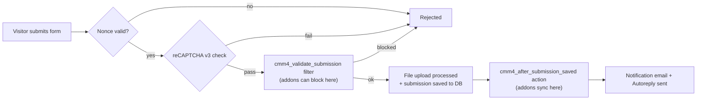

# Custom Minimalist Mailer (CMM4)

**A lightweight, sandboxed WordPress form-builder and SMTP mail engine — built around a self-contained, fault-isolated addon architecture.**

Originally engineered for the ALK (Alkhidmat) Elementor theme, CMM4 replaces generic form-plugin bloat with a single, auditable core file plus small, hot-pluggable addons. No external PHP libraries, no Composer dependencies — just WordPress core functions, talking directly to third-party APIs over HTTP.

<p>
  
  
  
</p>

### Built With

<p>
  
  
  
  
  
  
</p>

---

## Table of Contents

- [Overview](#overview)
- [Key Features](#key-features)
- [Supported Field Types](#supported-field-types)
- [Bundled Addons](#bundled-addons)
- [Architecture](#architecture)
- [Installation](#installation)
- [Quick Start](#quick-start)
- [Field Syntax Reference](#field-syntax-reference)
- [Shortcode Reference](#shortcode-reference)
- [Admin Menu Guide](#admin-menu-guide)
- [Security](#security)
- [File Uploads & Data Export](#file-uploads--data-export)
- [Building Your Own Addon](#building-your-own-addon)
- [Requirements](#requirements)
- [Project Structure](#project-structure)
- [Component Versions](#component-versions)
- [License](#license)
- [Author](#author)

---

## Overview

CMM4 turns any WordPress page into a fully configurable form — contact forms, job applications, inquiry forms — rendered through a single shortcode, routed through your own SMTP server, and logged to a dedicated database table. Every field (layout, validation, labels, options) is defined in one simple text block per form, no page-builder lock-in required.

On top of that core, an **addon system** lets specific features (Google Sheets sync, location-based eligibility rules, a visual field builder) live in their own self-contained files — each one optional, independently versioned, and isolated so that a bug in one addon can never take down the rest of the site.

## Key Features

| Feature | Description |
|---|---|
| **Shortcode form builder** | `[cmm4_form id="123"]` renders a fully responsive, multi-column form from a simple field list — no visual builder lock-in. |
| **Custom SMTP Gateway** | Route outgoing mail through any SMTP provider (host, port, encryption, auth) instead of relying on the server's default mailer. |
| **Submission Log** | Every submission is saved to a dedicated database table and viewable, searchable, and exportable from the admin dashboard. |
| **Autoreply Studio** | Send a branded, WYSIWYG-authored confirmation email to the person who submitted the form. |
| **Email Branding** | Add a logo (position, alignment, width, padding) to both notification and autoreply emails. |
| **Security Shield** | Optional Google reCAPTCHA v3, loaded only on pages that actually contain a form. |
| **Data Retention control** | Choose whether uninstalling the plugin wipes all data or leaves it untouched — your decision, not a default. |
| **Secure file uploads** | Resumes/attachments are stored outside the public media library, with randomized filenames and HMAC-signed download links. |
| **CSV & ZIP export** | Export a single form's submissions to CSV, or bulk-export every application and its attached resume as one ZIP archive. |
| **Addon ecosystem** | Drop a folder into `/addons`, and it's auto-discovered, version-gated, and individually toggleable — no core file edits required. |

## Supported Field Types

Fields are defined per form in a simple pipe-delimited syntax (see [Field Syntax Reference](#field-syntax-reference)). Supported `type` values:

| Type | Renders as |
|---|---|
| `text`, `email`, `tel`, `number`, `date`, `url`, … | Any native HTML5 input type — passed straight through to the `type` attribute. |
| `textarea` | Multi-line text box. |
| `select` | Dropdown populated from a comma-separated options list. |
| `checkbox` | A single checkbox, or a multi-option checkbox group if options are supplied. |
| `radio` | A radio button group from a comma-separated options list. |
| `file` | Upload field with an extension allow-list (defaults to `pdf, doc, docx`) and a 5MB cap. |
| `acf_locked` | Read-only field, auto-filled from an Advanced Custom Fields value on the current post (e.g. a job's "Department"). |
| `acf_dropdown` | Dropdown populated live from an ACF field's choices on the current post. |
| `acf_checkbox` | Multi-option checkbox list populated live from an ACF field on the current post. |
| `acf_radio` | Radio group populated live from an ACF field on the current post. |
| `geo_province`, `geo_district`, `geo_city` | Cascading Pakistan location dropdowns, provided by the **Pakistan Location Dropdowns** addon. |

Addons can also register entirely new field types via the `cmm4_render_custom_field` filter, without touching the core file.

## Bundled Addons

| Addon | Folder | What it does | Requires CMM4 |
|---|---|---|---|
| **Pakistan Location Dropdowns** | `geo-locations` | Cascading Province → District → City selects. Covers Punjab, Sindh, Khyber Pakhtunkhwa, Balochistan, and Islamabad Capital Territory. | 6.12.0+ |
| **Job Application Sync** | `job-application-sync` | Logs every job application to a Google Sheet and saves the resume to Google Drive, using your own Google account via OAuth 2.0 — no service-account JSON files. | 6.10.0+ |
| **Application Guard** | `application-guard` | Eligibility rules for job forms: blocks duplicate applications (same email *or* phone, normalized) and restricts applicants by District / City / Province. | 6.10.0+ |
| **Visual Field Editor** | `visual-field-editor` | Replaces the raw pipe-delimited textarea on the Edit Form screen with a click-based UI (add, delete, reorder, edit fields) — same storage format underneath, so raw mode still works. | — |

<details>
<summary><strong>Job Application Sync — one-time setup</strong></summary>

1. In [Google Cloud Console](https://console.cloud.google.com), create a project and enable the **Google Sheets API** and **Google Drive API**.
2. Go to **APIs & Services → Credentials → Create Credentials → OAuth client ID**. Application type: *Web application*.
3. Under **Authorized redirect URIs**, add the URL shown on **CMM Forms → Job Application Sync** (looks like `https://yoursite.com/wp-admin/admin.php?page=cmm4-job-app-sync`).
4. Copy the Client ID and Client Secret into the addon's settings page and save.
5. Click **Connect with Google** and approve access using the account that owns your target Sheet and Drive folder.
6. Fill in the Spreadsheet ID (from the sheet's URL, between `/d/` and `/edit`), the Drive Folder ID (from the folder's URL, after `/folders/`), and the Job Application Form ID(s) to watch.
7. Enable Sync, save, then use **Send Test Row** to confirm the Sheet and Drive folder are both reachable before relying on it for real applications.

> Until the OAuth app is submitted for Google's verification review, the consent screen shows an "unverified app" warning — normal for single-user apps. Click **Advanced → Go to (app name) (unsafe)** to proceed.
</details>

<details>
<summary><strong>Application Guard — one-time setup</strong></summary>

1. Go to **CMM Forms → Application Guard**.
2. Enter the Job Application Form ID(s) this should apply to (comma-separated for multiple).
3. Turn on the rules you want — duplicate blocking, and/or up to three independent location rules.
4. For each location rule, make sure the form has a matching field. A dropdown field type is recommended so applicants can only pick from your list — the rule is then re-checked server-side regardless, so tampering with submitted data can't bypass it.
</details>

## Architecture



**Core building blocks:**

- A hidden custom post type, `cmm4_form`, stores each form's configuration as post meta.
- A dedicated table, `{wp_prefix}cmm4_submissions`, stores every submission (created on activation, re-checked on `init`).
- The shortcode render engine (`cmm4_shortcode_render`) turns a form's field list into responsive HTML on the fly.
- The addon loader scans `/addons/{slug}/{slug}.php` automatically — no registration step, no edits to the core file. Addons can be toggled individually from **CMM Forms → Addons**, and a fatal error in one addon is caught and logged without affecting the rest of the site.

## Installation

1. Upload the `custom-mailer-v6-geo` folder to `/wp-content/plugins/`, or install the ZIP via **Plugins → Add New → Upload Plugin**.
2. Activate **Custom Minimalist Mailer (CMM4)** from the Plugins screen.
3. Go to **CMM Forms → SMTP Gateway** and enter your mail server's host, port, encryption type, and credentials.
4. (Optional) Visit **CMM Forms → Addons** to enable Pakistan Location Dropdowns, Job Application Sync, Application Guard, or Visual Field Editor.
5. Create your first form from the **CMM Forms** dashboard.

## Quick Start

1. **CMM Forms → Add New Form**, define the fields using the pipe syntax below (or the Visual Field Editor, if enabled).
2. Copy the form's ID from the dashboard list.
3. Drop the shortcode onto any page or post:

```
[cmm4_form id="123"]
```

## Field Syntax Reference

Each line in a form's field list defines one field:

```
Label|type|required|placeholder|css_class|options
```

| Part | Required | Meaning |
|---|---|---|
| `Label` | Yes | Field label. Supports a small safe subset of inline HTML (e.g. a link inside a consent checkbox label). |
| `type` | Yes | One of the [supported field types](#supported-field-types). |
| `required` | No | Literally the word `required` to make the field mandatory, or leave blank. |
| `placeholder` | No | Custom placeholder text. Falls back to the label if left blank. |
| `css_class` | No | Extra CSS class(es). Add `full-row` to force the field to span the whole form width. |
| `options` | No | Comma-separated choices (`select`/`radio`/`checkbox`), accepted file extensions (`file`), or an ACF field name (`acf_*` types). |

**Example field list:**

```
First Name|text|required|||
Phone Number|tel||+92 300 0000000||
Project Details|textarea|required|Tell us about your project...||
Budget Range|select|required|||Under $1k, $1k - $5k, $5k+
I agree to the privacy policy|checkbox|required|||
Services Required|checkbox||||Apparel Sourcing, Brand Design, Logistics
Street Address|text|required||full-row|
Resume|file|required|||pdf, doc, docx
Department|acf_locked|required||full-row|department
Available Positions|acf_dropdown|required||full-row|positions
Skills You Have|acf_checkbox|||full-row|skills
Shift Preference|acf_radio|required|||shift_options
Gender|radio|||full-row|Male, Female, Other
District|select|required|||Ghotki, Mirpur Mathelo, Daharki, Ubaro
Province|select|required|||Sindh, Punjab, KPK, Balochistan
```

## Shortcode Reference

```
[cmm4_form id="2659"]
[cmm4_form id="2659" cols="2"]
[cmm4_form id="2659" cols="3" labels="no"]
[cmm4_form id="2659" cols="1" label_position="left"]
```

| Attribute | Values | Default | Description |
|---|---|---|---|
| `id` | Form post ID | — | **Required.** The form to render. |
| `labels` | `yes` / `no` | `yes` | Show or hide field labels. |
| `label_position` | `top` / `left` | `top` | Label placement relative to the input. |
| `cols` | `1` / `2` / `3` | `1` | Number of responsive layout columns. |

## Admin Menu Guide

All screens live under **CMM Forms** in the WordPress admin sidebar:

| Menu Item | Purpose |
|---|---|
| **Minimal Mailer** (dashboard) | List, create, and manage forms. |
| **Submissions** | View, search, and export a form's logged submissions (CSV, single-row, or bulk ZIP with resumes). |
| **SMTP Gateway** | Configure the outgoing mail server. |
| **Autoreply Studio** | Enable and compose the auto-reply email sent to each submitter. |
| **Email Branding** | Add an optional logo to notification/autoreply emails. |
| **Security Shield** | Enable Google reCAPTCHA v3 and set the site/secret key pair. |
| **Data Retention** | Choose what happens to plugin data when it's uninstalled. |
| **Addons** | Enable/disable installed addons and see their version and load status. |

## Security

- **Nonce verification** on every form submission, tied to the specific form ID.
- **reCAPTCHA v3**, loaded only on pages that actually contain a `[cmm4_form]` shortcode — never site-wide.
- **Private file storage**: uploads live outside the public media library, in a folder blocked by `.htaccess`, with randomized filenames. Downloads require an admin login *and* a valid HMAC signature derived from the site's own `AUTH_KEY`/`AUTH_SALT` — links can't be forged or guessed.
- **Addon fault isolation**: a fatal error in one addon is caught and logged per-request; it cannot crash the core plugin or other addons.
- **Version gating**: an addon that declares `Requires CMM4 at least` is skipped (with a clear admin-visible reason) if the running core version is older — never silently fails with a fatal error.
- **CSV injection protection**: exported values are prefixed to prevent spreadsheet apps from treating submitted data as a formula.

## File Uploads & Data Export

- **Uploads** are validated against a configurable extension allow-list (default `pdf, doc, docx`), capped at 5MB, and stored outside the public upload directory.
- **CSV export** is available per-form, including a one-click download of a single submission's data.
- **Bulk ZIP export** packages every application for a form *and* every attached resume file into one archive — nonce-protected so it can't be triggered by a crafted URL.

## Building Your Own Addon

Drop a new folder into `/addons/{your-addon-slug}/{your-addon-slug}.php` — it's picked up automatically on the next page load, no core file edits needed.

```php
<?php
/**
 * Addon Name: My Addon
 * Description: One line describing what it does.
 * Version: 1.0.0
 * Author: Your Name
 * Requires CMM4 at least: 6.10.0
 */

if ( ! defined( 'ABSPATH' ) ) {
    exit;
}

// Your addon logic, hooked into one or more of the points below.
```

All header fields are optional — an addon with no header still loads, showing its folder name on the Addons screen instead of a friendly name.

**Available hook points:**

| Hook | Type | Signature | Fires |
|---|---|---|---|
| `cmm4_admin_menu_after` | Action | — | After core admin menu items are registered. Add addon submenu pages here. |
| `cmm4_fields_editor_ui` | Filter | `$default_html, $form_id, $fields_raw` | Lets an addon replace the raw textarea field editor with a custom UI. |
| `cmm4_before_form_render` | Action | `$form_id, $atts` | Before the shortcode builds the form's HTML. |
| `cmm4_render_custom_field` | Filter | `$html, $type, $name, $classes, $styles, $required` | Lets an addon render a new field type. Return HTML to claim it, or leave `null`. |
| `cmm4_validate_submission` | Filter | `'', $form_id, $clean_data` | Return a non-empty message to block/reject a submission before it's saved or emailed. |
| `cmm4_after_submission_saved` | Action | `$form_id, $clean_data, $submission_id` | Right after a submission is logged to the database — the place to sync data elsewhere. |
| `cmm4_notification_email_rows` | Filter | `$rows_html, $clean_data, $form_id` | Lets an addon adjust the notification email's field rows. |

## Requirements

- A standard WordPress installation — CMM4 uses only WordPress core functions, with **no external PHP libraries or Composer dependencies**.
- MySQL / MariaDB (via `$wpdb`, WordPress's own database layer).
- **Job Application Sync** addon: a Google Cloud project with the Sheets and Drive APIs enabled, plus an OAuth 2.0 Client ID/Secret (free tier is sufficient).
- **Security Shield**: a Google reCAPTCHA v3 site/secret key pair (optional).
- **ACF field types** (`acf_locked`, `acf_dropdown`, `acf_checkbox`, `acf_radio`) require Advanced Custom Fields to be active on fields tied to the relevant post type.

## Project Structure

```
custom-mailer-v6-geo/
├── custom-mailer-v6.php              # Core plugin: CPT, admin UI, render engine, submission router
├── uninstall.php                     # Cleanup on delete (respects the Data Retention setting)
└── addons/
    ├── geo-locations/
    │   ├── geo-locations.php         # Pakistan Location Dropdowns
    │   └── geo-data.php              # Province > District > City dataset
    ├── job-application-sync/
    │   ├── job-application-sync.php  # Google Sheets & Drive sync (OAuth 2.0)
    │   └── uninstall.php
    ├── application-guard/
    │   ├── application-guard.php     # Duplicate-blocking & location eligibility rules
    │   └── uninstall.php
    └── visual-field-editor/
        └── visual-field-editor.php   # Click-based field builder UI
```

## Component Versions

| Component | Version |
|---|---|
| Core plugin (CMM4) | 6.13.0 |
| Pakistan Location Dropdowns | 1.2.0 |
| Job Application Sync | 3.0.2 |
| Application Guard | 2.0.1 |
| Visual Field Editor | — (unversioned utility addon) |

## License

No license file is bundled with this repository. This plugin was built as a custom, site-specific tool; if you intend to distribute or open-source it, add a `LICENSE` file (MIT is a common, permissive choice for WordPress plugins) before publishing.

## Author

**Amanullah Khan**

Developer & Maintainer — Web Development, Front-End Engineering & Social Media Management
📍 Pakistan

<p>
  <a href="https://github.com/amanullahykhan"></a>
  <a href="https://huggingface.co/ak32khan"></a>
  <a href="https://www.linkedin.com/in/amanullahykhan/"></a>
  <a href="https://amanullahykhan.gumroad.com/l/niekk"></a>
</p>
